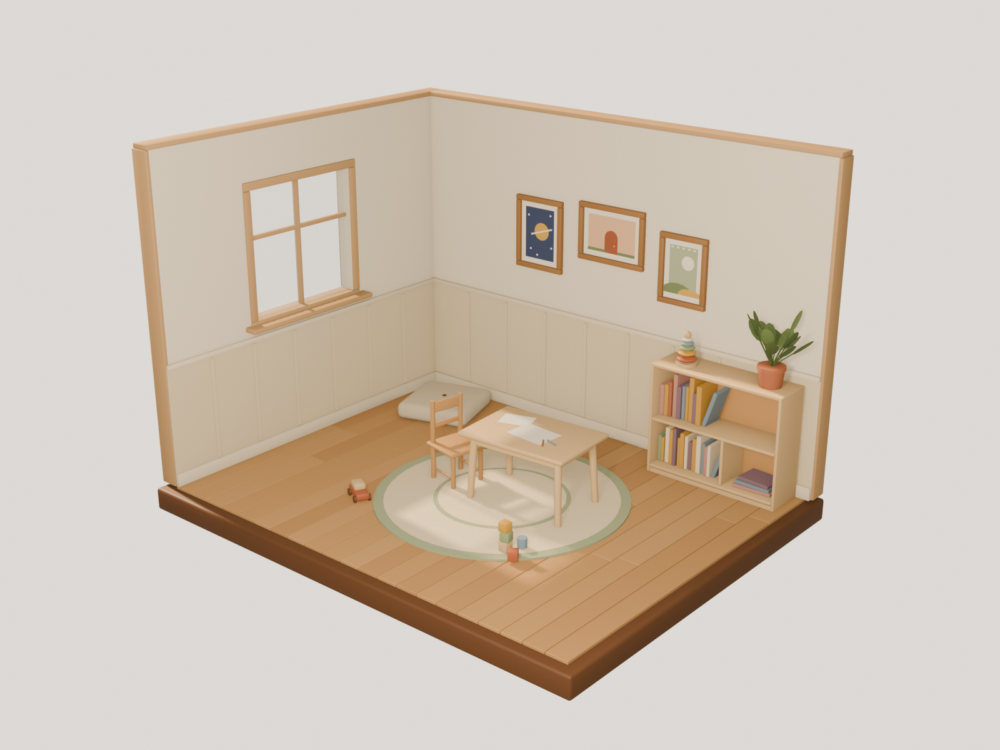

# 3D Lab — miniature children's room (experiment)

A prototype of the RootMap "little house" as a real 3D room: an open-front,
dollhouse-style children's room built entirely by a Blender Python script,
exported to glTF, and previewed on the website at **`/3d-lab`**.

This is an isolated experiment. It doesn't replace the homepage or the
challenge pages, and nothing on the site links to it.



## What's here

| Path | What it is |
| --- | --- |
| `experiments/3d-room/blender/build_room.py` | **Source of truth.** Builds the whole scene procedurally. Edit this, not the `.blend`. |
| `experiments/3d-room/output/little_room.blend` | Generated Blender project (can be regenerated at any time). |
| `experiments/3d-room/output/preview.png` | Reference render from the Blender camera, used to check the look. |
| `public/3d-lab/little-room.glb` | Exported model the website loads (~575 KB, ~16k triangles, no textures). |
| `src/pages/ThreeDLabPage.tsx` | The `/3d-lab` page (lazy-loaded, so three.js isn't in the main bundle). |
| `src/features/threeDLab/RoomViewer.tsx` | React Three Fiber canvas: lighting, camera limits, frame highlight. |
| `src/features/threeDLab/frames.ts` | Maps the three frame object names to challenge slugs. |

## 1. Run the Blender script

On macOS, Blender is usually **not** on your `PATH`, so call the binary inside
the app bundle. From the repository root, run:

```bash
/Applications/Blender.app/Contents/MacOS/Blender -b \
  --python experiments/3d-room/blender/build_room.py -- --all
```

`-b` runs Blender without its window. Flags after `--`:

| Flag | Effect |
| --- | --- |
| `--save` | Writes `experiments/3d-room/output/little_room.blend` |
| `--export` | Writes `public/3d-lab/little-room.glb` |
| `--render` | Renders `experiments/3d-room/output/preview.png` (EEVEE, about 2 s) |
| `--all` | All three |
| *(none)* | Builds the scene only |

The script prints a short summary, for example
`26 mesh objects, 15928 triangles, 41 materials`. Re-running it is safe
because it clears the scene first.

Optional: to call plain `blender`, add an alias such as
`alias blender=/Applications/Blender.app/Contents/MacOS/Blender`.
The script was written against **Blender 5.2**. It should also work on 4.2
or later, but only 5.2 has been tested.

## 2. Open the scene in Blender

- **Generated file:** open `experiments/3d-room/output/little_room.blend`
  (File → Open), or run
  `/Applications/Blender.app/Contents/MacOS/Blender experiments/3d-room/output/little_room.blend`.
- **Live from the script:** open Blender, go to the *Scripting* workspace,
  then Text → Open `build_room.py` and press **Run Script**. With no flags it
  only builds the scene. If paths resolve wrongly when you run it from inside
  Blender, launch Blender with `ROOTMAP_ROOT=/path/to/rootmap-play` set in the
  environment.

Press **Numpad 0** to look through `camera_three_quarter`, and switch the
viewport to *Rendered* shading (`Z` → Rendered) to see the lighting.

The collections in the Outliner:

| Collection | Contents | Exported? |
| --- | --- | --- |
| `Room_Shell` | Base, floorboards, walls, wainscot/trim, window, glass | Yes |
| `Furniture` | Rug, table (+ drawing), chair, cushion, bookshelf | Yes |
| `Books` | Book rows and stack (children of the bookshelf) | Yes |
| `Wall_Art` | `frame_pocket_universe`, `frame_secret_room`, `frame_life_movie` (+ `*_art` children) | Yes |
| `Plants` | Potted plant on the bookshelf | Yes |
| `Toys` | Stacking rings, blocks, wooden car | Yes |
| `Lighting` | `sun_window`, `fill_front` | No (Blender only) |
| `Camera` | `camera_three_quarter` | No (Blender only) |

## 3. Export the GLB

The normal path is `--export` (or `--all`) above. It selects every object in
the exported collections and writes `public/3d-lab/little-room.glb` with
modifiers applied, Y-up, and no lights or cameras.

To export by hand from Blender instead:

1. Select everything except the `Lighting` and `Camera` collections.
2. Choose File → Export → glTF 2.0 (.glb).
3. Set **Format: glTF Binary**, tick **Include → Selected Objects**, and tick
   **Transform → +Y Up**. Leave **Data → Lighting** and **Camera** unticked.
4. Save over `public/3d-lab/little-room.glb`.

Keep the frame object names exactly as they are. The website finds the
frames by name.

## 4. Preview the model

**On the website (recommended):**

```bash
npm run dev
# open http://localhost:5173/rootmap-play/3d-lab
```

- Drag to orbit gently. The angle is limited so you never see behind the
  walls or under the floor.
- Scroll or pinch to zoom, within limits. Panning is off.
- Hover a frame to make it glow slightly, lift off the wall and show its
  title.
- Click or tap a frame to show a card with the challenge title and a link
  to `/challenges/:slug`.
- The buttons under the canvas select the same frames, for keyboard and
  screen-reader users.
- Titles come from the published challenge data. If a challenge can't be
  found, the page uses the fallback title in `frames.ts`.

**Without the site:** drop the `.glb` into <https://gltf-viewer.donmccurdy.com/>
(it runs locally in your browser), or use macOS Quick Look (select the
file and press Space).

## 5. Modify the scene

All edits go in `build_room.py`, followed by a re-run with `--all`.

### Furniture and layout

- Each piece has its own `build_*` function, for example `build_table`,
  `build_chair`, `build_bookshelf` and `build_toys`.
- Inside each function, sizes are in **metres** at real child-furniture
  scale. For example, the table is 0.50 m tall and the chair seat is
  0.28 m.
- To **move or rotate a piece**, change the `location=` and `rotation=`
  passed to `.build(...)` at the end of its function. Blender axes are
  Z-up, `+Y` points into the room toward the back wall, and the open sides
  face `-Y` (front) and `+X` (right).
- **Room size and window** are set by `ROOM_W`, `ROOM_D`, `WALL_H` and
  `WINDOW` near the top of the file.
- **Picture frames** are listed in `build_frames()` → `specs`, as name,
  width, height, x and z. If you rename a frame, also update
  `src/features/threeDLab/frames.ts`.
- **Shape building blocks:** `Part.box(..., bevel=)`, `Part.cylinder(...)`
  and `Part.sphere(...)`. Bevels are baked into the mesh, so the glTF looks
  the same as the render.

### Materials and colour

- Every colour is in the `PALETTE` dict at the top of the file, as
  `name: (sRGB hex, roughness)`. Change a value there and it updates
  everywhere that material is used.
- Materials are plain Principled BSDF (base colour, roughness, alpha),
  which map 1:1 onto glTF PBR. Avoid procedural texture nodes: glTF can't
  carry them. Image textures would export, but add file size.

### Lighting

- **In Blender:** use the `LIGHTING` dict. `sun_direction` is the direction
  the sunlight travels. It is aimed low through the window so a patch of
  light with mullion shadows falls on the rug. The dict also sets the sun's
  strength and colour, the front fill light, the ambient world colour and
  the backdrop colour.
- **On the website:** lights are *not* exported. They're set up in
  `RoomViewer.tsx` (hemisphere, sun-direction light with shadows, and a soft
  front fill). `SUN_DIRECTION` there mirrors the Blender value, converted
  from Blender `(x, y, z)` to three.js `(x, z, -y)`. If you change the sun in
  one place, change it in the other.
- The camera works the same way: `CAMERA_POSITION` and `CAMERA_TARGET` in
  `RoomViewer.tsx` mirror `camera_three_quarter`. Orbit and zoom limits are
  the `OrbitControls` props.

## Performance notes

- About 16k triangles, 26 meshes, 41 small flat-colour materials and no
  textures. Lightweight for phones.
- The 3D route is code-split. The page chunk is about 270 KB gzipped and
  loads only on `/3d-lab`.
- The GLB is about 575 KB uncompressed. Most static hosts gzip it. Draco or
  meshopt compression could shrink it further, but either one needs a
  decoder at runtime, so neither is used yet.
- Possible next steps: merge meshes that share materials, add a baked
  ambient-occlusion texture for richer contact shadows, and add subtle
  wood-grain textures.
